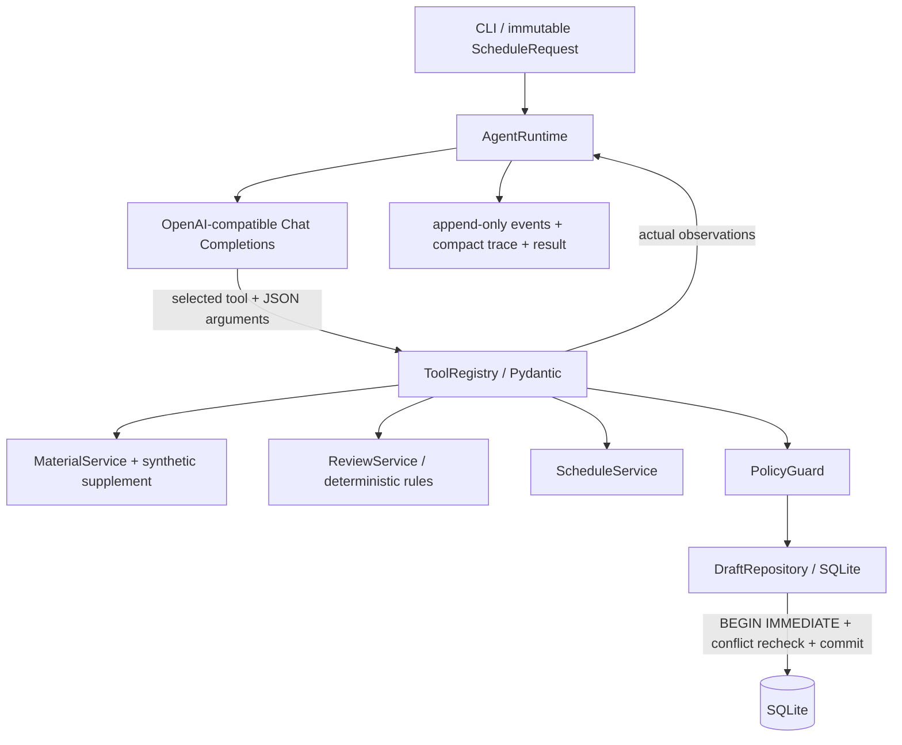

# 实际实现

## 调用关系

## 模型决策循环

`src/agent.py` 每轮把完整的系统指令、原始请求、此前 assistant 工具调用及对应 tool 观察提交给模型。`src/llm.py` POST `/chat/completions`，传 `tools` JSON Schema、`tool_choice=auto`、`parallel_tool_calls=false`。模型选择工具、参数或结束；运行时校验并执行，然后把真实工具响应追加回上下文。

运行时没有“发现 18 点冲突则自动改 19 点”的决策分支，没有模型调用重试。即使提供方返回多工具批次，工具按顺序执行且逐项计算预算。模型可以自主重新查询和重试保存。SQLite 的锁等待属于事务协调，不属于替模型规划。

`reason_summary` 是动作的简短公开目的，不请求私有推理链。适配器不读取或保留 `reasoning_content` 等隐藏推理字段。实际 DeepSeek 运行显式使用 `thinking.type=disabled`，通过 `LLM_EXTRA_BODY` 配置；额外配置禁止覆盖消息、模型和工具等关键字段。

协议参考实际打开的 [OpenAI Function Calling](https://developers.openai.com/api/docs/guides/function-calling)、[DeepSeek Tool Calls](https://api-docs.deepseek.com/guides/tool_calls/) 和 [DeepSeek Chat Completions](https://api-docs.deepseek.com/api/create-chat-completion/)。本项目适配 Chat Completions；仅支持其他接口的模型不能直接替换使用。

## 工具与职责边界

| 工具 | 实际输入 | 权威上下文与行为 |
|---|---|---|
| read_material | ID、公开动作目的 | 从合成 JSON 返回真实记录，计算缺失字段 |
| lookup_material_info | ID、公开动作目的 | 只允许可信合成补查源修补许可字段；可能仍缺失，补查使旧审核失效 |
| check_review_rules | ID、公开动作目的 | 用已读取数据和原始请求执行确定性规则；不接受模型伪造的素材或审核状态 |
| query_schedule | ID、带偏移的时间、公开动作目的 | 渠道和市场绑定原始请求；返回实际冲突、可搜索窗口和间隔规则，由模型选择下一次查询 |
| save_schedule_draft | ID、建议时间、确认状态、公开动作目的 | 要求已读、已审、已查；重审，Guard 验证，数据库提交后才返回成功 |

模型不可改 request_id、市场、渠道、硬性约束或确认列表。未知工具、额外参数、非法 JSON、无偏移时间、越界素材、未完成前置动作都会产生结构化拒绝，并返回模型作为下一轮观察。

许可明确禁止或超出渠道市场范围 BLOCKED；许可未知和必填字段缺失 NEEDS_INFO；语言不符、未核实宣传声明与人工风险标签 NEEDS_REVIEW。规则优先级是 BLOCKED > NEEDS_INFO > NEEDS_REVIEW > PASS。

## 时间与确认

模型只能在用户窗口内提出未确认替代；硬性时间的替代必须 PENDING，软偏好窗口内可 WITHIN_FLEXIBILITY。精确 `user_confirmations` 输入允许 USER_CONFIRMED 并持久化 material_id、target_time、confirmed_at、source。确认时间不能在未来或晚于目标时间。它是本地 CLI 的可信用户输入边界，没有实现身份认证或签名审批。

确认后必须再次执行整个读取、审核、查询和保存流程。新确认输入产生新指纹；旧的待确认建议保留为审计记录，不会被自动升级。新 READY 草稿仍要经过当下的冲突校验；若已被占用则拒绝保存。没有可变审批接口。

## 事务和幂等

原始 Pydantic 请求规范化为键排序 JSON，时间转换为 UTC，素材及确认列表排序，计算 SHA-256。request_id 也参与指纹：调用方必须复用同一个 ID 重试；新的 ID 表示独立需求，不被错误合并。数据库唯一键 `(request_fingerprint, material_id)` 支持多素材独立保存。

保存顺序是 `BEGIN IMMEDIATE → 查同指纹已有记录 → 当前时段二次查询 → Guard → INSERT → COMMIT`。已有记录返回原 ID 与原内容，不修改草稿，也不表示本次新建议已被接受。锁覆盖二次检查与插入，避免两个进程同时占用同一时段。唯一约束提供幂等最终保证。SQLite WAL 与 10 秒 busy timeout 适合此单机最小实现。

`--simulate-save-failure` 在真实 INSERT 后、COMMIT 前抛出 SQLite 异常并回滚；这是明确的故障注入，不伪造持久化结果。最终输出还会再次读取已提交记录验证 ID；访问失败返回 INCOMPLETE 和验证错误，不能宣称已验证保存成功。

## 执行预算与观测

默认最大 16 个模型决策轮次、24 次工具调用，CLI 可调整但有上界；非法调用同样消耗工具预算。还有最终总结预算时允许模型结束；若仍请求工具而额度已用尽则 INCOMPLETE。每次模型请求默认 45 秒 httpx 超时，网络、HTTP、协议、截断和适配器错误都有结构化结果，没有自动重试或 Mock 回退。

每次生成 UUID run_id。`events.jsonl` 追加来源快照、请求、模型响应标识、工具调用、完整必要观察、usage 和最终状态；`trace.json` 提供每一步的动作、公开依据、参数、返回摘要和下一实际动作；`result.json` 保存权威结果。来源快照对 src/*.py 和 data/*.json 逐文件计算 SHA-256，方便对应最终代码。原始事件不被评估脚本修改。

日志按环境中已知密钥和 `sk-` 模式脱敏，不记录 HTTP Authorization、提供方错误响应正文或无关完整上下文。实际 token usage 原样保留；缺失标 `unavailable`。最终自然语言属于非权威记录，业务状态以结构化输出和数据库为准。

## 取舍

原生 Tool Calling、Pydantic、httpx、SQLite、pytest 足够验证核心能力，因此没有引入 Agent 框架、前端、RAG、MCP、视觉模型或多 Agent。MockModel 只是一套明确标注的脚本模拟器，验证相同工具与存储链路，不证明真实 Agent 能力。每个评估场景使用独立数据库，避免不同场景互相占位；重复场景专门跨两个独立 Python 进程复用同一数据库。
